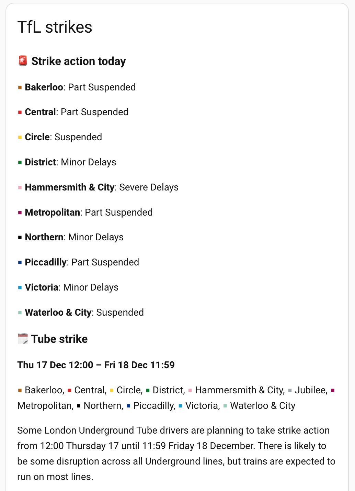
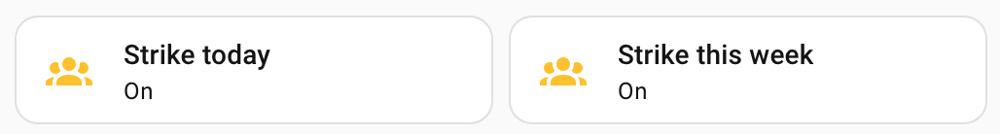

# HA-LondonTfL - Home Assistant London TfL Integration

[](https://github.com/hacs/integration)


## Introduction

Simple Home Assistant sensor to retrieve departures from Transport for London stations.
Each station creates its own sensor.

## Installation

Easiest method is to get it via HACS! If you're unfamiliar with HACS, go [here](https://hacs.xyz/docs/setup/prerequisites).
Should be easily found under Integrations - `London TfL`.

Alternatively, you can manually drop it into your `custom_components` folder.

## Setup

You can add integration via the Integrations menu by searching for `London TfL`.
It will auto-populate the line list, then auto-populate the station list with all stations on that line.
It will allow you to add as many stations as needed.
After picking a station you can optionally filter to a single platform. The dropdown lists the platforms TfL is currently
reporting departures for at that station; if yours isn't listed (e.g. nothing is due there right now) you can type it in.
The filter matches on the platform name as TfL reports it, with the `Platform ` prefix removed — e.g. `Eastbound - 2` or `14`.
For bus stops the "platform" is the route number.

To follow one direction of a station on the Underground, set the platform filter to part of the platform name shown in the sensor's `platform` attribute (for example `Westbound`). A stop with a platform filter is named `Station (filter)` and its entity id includes the filter, so the two directions of the same station and line get different, stable names. Without a filter the name is `Station to <destination of the next train>` and covers every platform.

### Direction and calling-at filters (Tube, Elizabeth line, Overground, DLR, tram)

TfL's live feeds often say little about which way a train is going. The Elizabeth line feed has no direction field at all, and in central London (Liverpool Street, Farringdon, Paddington and others) reports every train as `Platform Unknown`. The Overground reports many trains as `Platform Unknown` too and often leaves TfL's own direction field empty. DLR platforms are plain numbers. And at some stations (Stratford, for example) the same platform is reported as `Platform 5` for some trains and `Platform Unknown` for others. A platform filter therefore either can't split the directions or silently drops trains.

Stops on the Tube, Elizabeth line, Overground, DLR and trams can instead use two extra options on the platform step (and under **Configure → Edit stop**). Both are worked out from TfL's route data for the line (fetched once a day) and each train's destination, rather than the platform:

- **Direction of travel** (`Eastbound`, `Westbound`, `Northbound`, `Southbound`: whichever the line runs in from your station) keeps every train heading that way. It keeps working when trains are diverted to another platform, change destination by time of day or terminate early. This is usually all you need.
- **Calling at** keeps only trains whose route from your station passes through (or ends at) the chosen station. Use it when one direction splits into branches you don't want: from Liverpool Street, `Calling at: Stratford` keeps the Shenfield trains and leaves out the Abbey Wood ones; on the Northern line, a station on the Bank branch keeps out trains via Charing Cross.

Things to know:

- **Leave the platform filter blank** on Elizabeth line, Overground and DLR stops and use these instead. On the Tube, platform names already include a direction (`Westbound - Platform 2`), so the platform filter works there too.
- **On branching lines a train takes the direction of the route it runs on**, and only directions some train from your station actually takes are offered. At Earl's Court on the District, Upminster and Edgware Road trains are eastbound; Ealing Broadway, Richmond, Kensington (Olympia) and Wimbledon trains are westbound. Where two routes leaving the same way point differently overall (from the Wimbledon branch, Upminster trains count as eastbound but Edgware Road trains as northbound), use Calling at with a station they share, such as Earl's Court, to get them all.
- **Loops have no direction.** TfL describes the Circle line as one route that goes round the loop back to Edgware Road, so a compass direction means nothing there and isn't offered; use Calling at instead.
- **Stations with two parts on the line**, like Liverpool Street and Paddington on the Elizabeth line (the Elizabeth line platforms underground and the main line station above), are listed once in Calling at and match both. That includes trains diverted to terminate at the main line station, as happens at Liverpool Street during disruption.
- **Calling at follows the route, not the individual train.** TfL doesn't publish each train's stopping pattern, so a train is kept if the route to its destination passes the chosen station.
- **Direction and Calling at must agree.** If you set both, the calling-at station has to lie in that direction from your stop; the form refuses a combination that could never show a train. Setting just one of them is normally enough.
- **If TfL's route data can't be loaded**, a filtered stop shows no trains rather than a mix of directions, and tries again 30 minutes later.
- **Changing a filter gives the sensor a new entity ID**, so update any cards or automations that use it.
- Buses aren't covered: use the platform filter (the route number) for those.

Examples (the sensor is named after its filters, e.g. `Liverpool Street (via Stratford)`, and its entity ID ends with them):

| Journey | Filter | Entity ID |
|---|---|---|
| Liverpool Street → Stratford | Calling at: Stratford | `sensor.london_tfl_elizabeth_910glivstll_via_910gstfd` |
| Stratford → Liverpool Street | Direction: Westbound | `sensor.london_tfl_elizabeth_910gstfd_westbound` |
| Stratford → Liverpool Street (either level) | Calling at: Liverpool Street | `sensor.london_tfl_elizabeth_910gstfd_via_hublst` |
| Hayes & Harlington → central London | Direction: Eastbound | `sensor.london_tfl_elizabeth_910ghayesah_eastbound` |
| Earl's Court → Wimbledon (District) | Calling at: Wimbledon (Direction: Westbound also includes Ealing and Richmond trains) | ends `_via_<station id>` |
| Southfields → central London (District) | Calling at: Earl's Court | ends `_via_<station id>` |
| Baker Street → King's Cross (Circle) | Calling at: King's Cross St. Pancras | ends `_via_<station id>` |

Sensor state is the next train departure time from the given station and platform (if set).
Attributes contain up to `max` departures.

Sensor name will change to the name of the first departure's destination station.
If you do not want this behaviour, you can change the name of the sensor manually.


### Alternate setup

You can still manually configure the integration, but it's not recommended.
Check https://github.com/morosanmihail/HA-LondonTfL/wiki/Manual-setup if you insist.

## Strike alerts

The integration can also tell you about strikes on the lines you use. It reads them from TfL's own line status data, the same information the [TfL strikes page](https://tfl.gov.uk/status-updates/strikes) shows, and checks hourly.

Turn it on from the integration's **Configure → Strike alerts**:

- **Track strikes**: adds the three entities below (turning it off removes them).
- **Lines to watch**: pick the lines you travel on. Leave it empty to watch every Tube, Elizabeth line, Overground, DLR and tram line.

| Entity | State | Attributes |
|---|---|---|
| `sensor.london_tfl_strikes` | When the next strike starts (or the one under way). `unknown` when none is announced in the next 30 days | `strikes`: each announced strike with `title`, `when` (e.g. `Thu 17 Dec 12:00 – Fri 18 Dec 11:59`), `start`, `end`, `active`, `lines`, `line_ids`, `line_colours`, `description` (TfL's text). `affected_now`: on a strike day, each line's live status (`line`, `status` such as `Part Suspended`, `description`, `until`, `colour`). Also `strike_count`, `watched_lines` |
| `binary_sensor.london_tfl_strike_today` | `on` when a strike affects a watched line for the rest of today: under way, starting later today, or reported in TfL's live status | `strikes`, `affected_now` |
| `binary_sensor.london_tfl_strike_within_7_days` | `on` when a strike is under way or starts within the next 7 days | `next_strike`, `strikes` |

Things to know:

- **Announced strikes and the day itself look different in TfL's data.** Before a strike, TfL publishes the announcement ("TUBE STRIKE: …") with its exact start and end. On the day, TfL replaces it with each line's live status ("Circle Line: No service on the entire line due to strike action"), which is what `affected_now` shows.
- Strikes are announced per line, so one strike covering all 11 Tube lines appears once, listing those lines.
- If TfL can't be reached, the strike entities show as unavailable until the next hourly check. Departure sensors are not affected.

### Dashboard cards

These use only the cards built into Home Assistant. Add a **Manual** card and paste the YAML. The Markdown card's `content: |` matters: with `content: >` YAML joins all the lines into one and the headings and line list run together.

A card listing every announced strike, which only appears when there is one:

```yaml
type: markdown
title: TfL strikes
visibility:
  - condition: state
    entity: sensor.london_tfl_strikes
    state_not: unknown
  - condition: state
    entity: sensor.london_tfl_strikes
    state_not: unavailable
content: |
  
  
  
  ### 🚨 Strike action today
  
  <font color="{{ l.colour }}">■</font> **{{ l.line }}**: {{ l.status }}
  
  
  
  ### {{ '🔴' if s.active else '🗓️' }} {{ s.title }}
  **{{ s.when }}**

  <font color="{{ s.line_colours[i] }}">■</font> {{ s.lines[i] }}{{ ', ' if not loop.last }}

  {{ s.description }}
  
```



*On a strike day: each line's live status, then the announced strikes (cropped after the first; the 19–20 December strike follows in the same format).*

At-a-glance tiles:

```yaml
type: grid
columns: 2
square: false
cards:
  - type: tile
    entity: binary_sensor.london_tfl_strike_today
    name: Strike today
  - type: tile
    entity: binary_sensor.london_tfl_strike_within_7_days
    name: Strike this week
```



### Notification example

```yaml
alias: TfL strike warning
triggers:
  - trigger: time
    at: "07:00:00"
conditions:
  - condition: state
    entity_id: binary_sensor.london_tfl_strike_today
    state: "on"
actions:
  - action: notify.notify
    data:
      title: TfL strike today
      message: >
        
        {{ live | map(attribute='line') | join(', ') }} affected.Strike starts today: {{ state_attr('binary_sensor.london_tfl_strike_today', 'strikes')[0].when }}.
```

## Viewing

Check out https://github.com/morosanmihail/HA-LondonTfL/wiki/Cards
