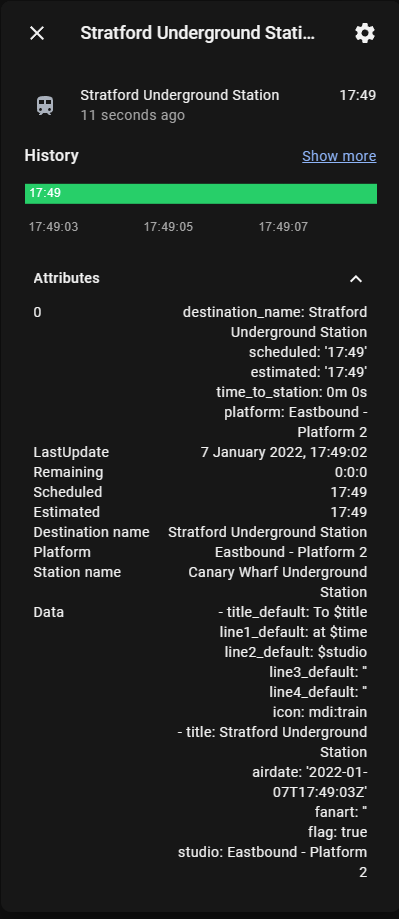

# HA-LondonTfL - Home Assistant London TfL Integration

## Introduction

Simple Home Assistant sensor to retrieve departures from Transport for London stations.
Each station creates its own sensor.

## Installation

Easiest method is to get it via HACS! If you're unfamiliar with HACS, go [here](https://hacs.xyz/docs/setup/prerequisites).
Should be easily found under Integrations - `London TfL`.

Alternatively, you can manually drop it into your `custom_components` folder.

## Setup

You can add integration via the Integrations menu by searching for `London TfL`.
It will auto-populate the line list, then auto-populate the station list with all stations on that line.
It will allow you to add as many stations as needed.
After picking a station you can optionally filter to a single platform. The dropdown lists the platforms TfL is currently
reporting departures for at that station; if yours isn't listed (e.g. nothing is due there right now) you can type it in.
The filter matches on the platform name as TfL reports it, with the `Platform ` prefix removed — e.g. `Eastbound - 2` or `14`.
For bus stops the "platform" is the route number.

To follow one direction of a station on the Underground, set the platform filter to part of the platform name shown in the sensor's `platform` attribute (for example `Westbound`). A stop with a platform filter is named `Station (filter)` and its entity id includes the filter, so the two directions of the same station and line get different, stable names. Without a filter the name is `Station to <destination of the next train>` and covers every platform.

### Elizabeth line: direction and calling-at filters

The Elizabeth line feed has no direction field, and in central London (Liverpool Street, Farringdon, Paddington and others) TfL reports every train as `Platform Unknown`, so a platform filter cannot split the two directions there. Elizabeth line stops therefore offer two extra options on the platform step, both worked out from TfL's route data (fetched once a day) instead of the platform or destination:

- **Direction of travel**: `Eastbound` or `Westbound`. Keeps every train heading that way, even when it is diverted to another platform, its destination changes by time of day or it terminates early.
- **Calling at**: a station further along the line, e.g. `Stratford` from Liverpool Street, which keeps the Shenfield trains and leaves out the Abbey Wood ones. TfL does not publish each train's stopping pattern, so this uses the route to the train's destination.

A stop using these is named after them, e.g. `Liverpool Street (Eastbound)` or `Liverpool Street (via Stratford)`, and its entity id includes them (`sensor.london_tfl_elizabeth_910glivstll_eastbound`, `sensor.london_tfl_elizabeth_910glivstll_via_910gstfd`). Both can be changed later from the integration's options.

Sensor state is the next train departure time from the given station and platform (if set).
Attributes contain up to `max` departures.

Sensor name will change to the name of the first departure's destination station.
If you do not want this behaviour, you can change the name of the sensor manually.

### Alternate setup

You can still manually configure the integration, but it's not recommended.
Check https://github.com/morosanmihail/HA-LondonTfL/wiki/Manual-setup if you insist.

## Viewing

Check out https://github.com/morosanmihail/HA-LondonTfL/wiki/Cards
